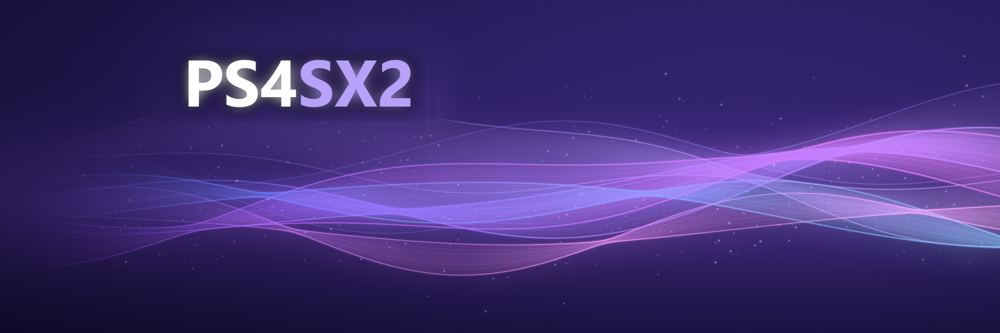

<p align="center">
  
</p>

<h3 align="center">PCSX2, the PS2 emulator, running natively on a jailbroken PS4.</h3>

<p align="center">
  
  
  
  
</p>

---

## What is PS4SX2?

PS4SX2 is a port of [PCSX2](https://github.com/PCSX2/pcsx2) to the PS4, built on top of [PS5SX2](https://github.com/Swordpdf/PS5SX2), the PCSX2 port for the PS5. It runs as a native app on a jailbroken console:

- PCSX2's recompilers run straight on the PS4's CPU.
- PCSX2's Vulkan hardware renderer draws on the PS4's GPU through a port of Mesa's RADV Vulkan driver to the console's graphics stack.
- You pick a game from PS5SX2's cover-flow shelf and play it.

It's an early, experimental port. Expect rough edges.

## Status

Tested on a **base PS4** (the package also turns on PS4 Pro mode, not yet measured there).

| Game | Result |
|---|---|
| **Grand Theft Auto: San Andreas** (SLUS-20946) | Runs. Menus and cutscenes at full speed; gameplay about 50% speed (~18 fps), limited by the base PS4's CPU. Widescreen patch works. |
| **Mortal Kombat: Shaolin Monks** (SLUS-21087) | Runs. 15 to 27 fps in the heavier scenes, limited by the GS renderer's CPU work. |

The base PS4's CPU is the main limit: the EE recompiler and the VU1 thread each fill one core. Lighter games should do better; reports are welcome.

## What you need

- **A jailbroken PS4** that can install fake packages (for example with GoldHEN).
- **Your own PS2 BIOS**, dumped from your own console.
- **Your own games**, as `.iso`, `.chd`, `.cso` or `.zso` files.

No BIOS, games or keys come with PS4SX2.

## Getting started

1. Install the package (`IV0000-PCSX00002_00-PCSX2PS4.pkg`). It shows up on the home screen as **PS4SX2**.
2. Put your BIOS in `/data/PCSX2/bios/`.
3. Put your games in `/data/PCSX2/games/`.
4. Optional: PCSX2 patch files (`.pnach`, widescreen, 60 FPS...) go in `/data/PCSX2/patches/`.
5. Start PS4SX2 and pick a game on the shelf.

Settings live in ini files under `/data/PCSX2/`: `gs.ini` for all games, and one ini per game. They use PCSX2's own setting names.

Logs (`boot.log` and friends) are written under `/data/PCSX2/` and are the most useful thing to send with a bug report.

## Building

The PS4 build lives in [`ps4/`](ps4). It reuses PS5SX2's console layer from `ps5/coreorbis` and the PCSX2 core, and replaces the PS5-only parts.

You need, in WSL or Linux:

- a clang toolchain targeting the PS4 with the [OpenOrbis](https://github.com/OpenOrbis/OpenOrbis-PS4-Toolchain) SDK (`OPENORBIS`, default `/opt/pacbrew/ps4/openorbis`),
- a PS4 sysroot with libc++ and glslang (`PS4_SYSROOT`), and the PS4 Vulkan (RADV) runtime the eboot links against (`PS4_PORT_DIR`),
- PCSX2's dependencies built for the PS4 (`PS4DEPS`, see `ps4/Makefile.ps4`).

Then:

```bash
ps4/build-ps4.sh            # compile and link the eboot
ps4/build-ps4.sh package    # also make the .pkg
ps4/build-ps4.sh upload     # package, then send it to the console's /data/pkg over FTP (set PS4_HOST)
```

`ps4/build-pgs.sh` optionally builds [paraLLEl-GS](https://github.com/Arntzen-Software/parallel-gs) (a Vulkan compute GS renderer) as a second renderer; it expects the checkout next to this repository, or in `PGS_SRC`.

`PCSX2_PS4_BIOS_DIR` can put your own BIOS files inside a package for your own console. Never share a package built that way.

## Credits

- [PCSX2](https://github.com/PCSX2/pcsx2) and its contributors: the emulator itself.
- [PS5SX2](https://github.com/Swordpdf/PS5SX2) by swordpdf: the console port this one is built on, its shelf and settings.
- [OpenOrbis](https://github.com/OpenOrbis/OpenOrbis-PS4-Toolchain): the PS4 homebrew toolchain.
- [Mesa](https://www.mesa3d.org/) RADV: the Vulkan driver behind the renderer.
- [paraLLEl-GS](https://github.com/Arntzen-Software/parallel-gs) by Themaister (optional renderer, LGPL-3.0-or-later).

The PS4 port was written with AI assistance (AI-assisted).

## Licence

GPL-3.0-or-later, as PCSX2. See [COPYING.GPLv3](COPYING.GPLv3).
